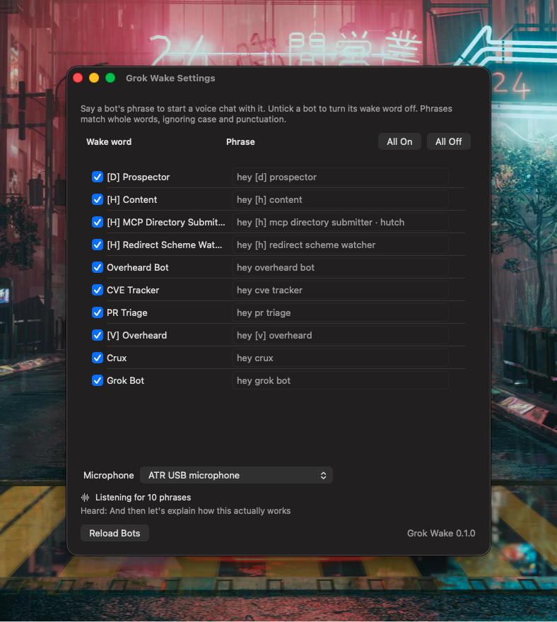

# Grok Wake

Say "hey research" and Grok Wake starts a voice chat with your Research bot in Grok Bot. It sits in the menu bar, listens for the phrases you set (one per bot), and when it hears one it opens that bot and presses its "Start voice chat" button for you.

Speech recognition runs on your Mac. No audio or text goes over the network, and Grok Wake stops listening while a call is going. See [Is Grok listening to everything I say?](#is-grok-listening-to-everything-i-say)

## Requirements

- macOS 13 (Ventura) or later, Apple silicon or Intel.
- Grok Bot, signed in, with at least one bot.
- On-device speech recognition for English (US). macOS downloads it when Dictation is on: System Settings > Keyboard > Dictation. You can turn Dictation off again afterwards; the download stays.

## Install

1. Download [**Grok-Wake.zip**](https://github.com/ExpeditedProjects/grokbot-wakeword-releases/releases/latest/download/Grok-Wake.zip) and double-click it to unzip.
2. Drag **Grok Wake** to your Applications folder.
3. Open it. If macOS asks whether to open an app downloaded from the internet, click **Open**.

Grok Wake appears in the menu bar, not the Dock. Keep it in Applications before turning on Launch at Login, so the login item points at the copy you keep.

## Update

Quit Grok Wake (menu > Quit), download the latest release, and replace the copy in Applications. Your phrases and permissions are kept.

## First run

Grok Wake starts with Listening off. Click its icon in the menu bar and turn **Listening** on. macOS then asks for:

1. **Microphone**, to hear your wake phrases.
2. **Speech Recognition**, to turn what it hears into text on your Mac.

It also needs **Accessibility**, to press Grok Bot's voice button. Click **Accessibility: Allow…** in the menu, then turn Grok Wake on in System Settings > Privacy & Security > Accessibility.

If you said no to a prompt, the menu shows a button that opens the right System Settings pane.

## Phrases

Open **Settings…** from the menu to see your bots. Each one has:

- a checkbox to turn its phrase on or off (all are on at first), and
- a phrase, which starts as "hey" plus the bot's name ("hey research" for Research). Type a new one to change it; clear the field to go back to the default.



Matching ignores case and punctuation and works on whole words, so "Hey, Research!" wakes Research but "hey researcher" doesn't. The phrase can come anywhere in what you say ("uh, hey research, what's up"). When the phrase is the last thing you said, Grok Wake waits about half a second to be sure you weren't in the middle of a longer word.

If two bots have the same phrase, Settings marks them with a warning and the one higher in the list wins. If one phrase starts another ("hey crux" and "hey crux two"), the longer one wins when you say it.

Bot names that speech recognition spells oddly (made-up words, brackets, initials) work better with a phrase in plain words. The **Heard** line at the bottom of Settings shows what Grok Wake last heard, which helps you pick a phrase it recognizes.

## The menu bar icon

| Icon | Meaning |
|---|---|
| Waveform | Listening |
| Pause | Listening is off |
| Phone | A call is starting or in progress (not listening) |
| Warning | Something needs attention; open the menu to see what |

## Is Grok listening to everything I say?

No. Grok hears nothing until you say a wake phrase and a voice chat starts. Until then, the only things listening are Grok Wake and Apple's speech recognition, and both run entirely on your Mac.

Grok Wake itself does hear everything said near your Mac while Listening is on; it has to, to catch your phrase. That's why macOS shows its orange microphone dot. But what it hears stays on your Mac, in memory only, and is replaced as you keep talking.

### How it works

1. **Your Mac turns speech into text.** Grok Wake passes the microphone's audio to macOS's built-in speech recognizer, the one Dictation uses, and requires it to run on your Mac. If your Mac could only do it through Apple's servers, Grok Wake shows an error and doesn't listen.
2. **Grok Wake looks for your phrases in that text.** As the text comes in, it checks for one of your enabled phrases as whole words. Everything else is ignored.
3. **The text is discarded regularly.** Recognition restarts about every 50 seconds and after every wake, which drops what came before. The latest text is kept in memory only, for the Heard line in Settings. Nothing is recorded, saved to disk or logged.
4. **A phrase starts an ordinary Grok Bot voice chat.** Grok Wake opens that bot in Grok Bot and presses Start voice chat, just as you would. From that moment you're on a normal Grok Bot call, and your voice goes to Grok the same as any call you start yourself.
5. **Grok Wake turns its microphone off for the call.** It stops listening while the call starts and runs, so it can't hear the conversation, and starts again after you hang up. It does this for calls you start yourself in Grok Bot too. The orange dot then belongs to Grok Bot alone, and Bluetooth headsets go back to high-quality audio after the call.

If Grok Wake mishears something as your phrase, that starts a real call. Hang up in Grok Bot. A phrase that's unlikely to come up in conversation makes this rarer.

### What Grok Wake never does

- Connect to the internet. It reads your bot list from Grok Bot's files on your Mac.
- Send audio or text to Grok, Apple or anyone else.
- Record audio or keep a transcript.

To stop it listening, turn **Listening** off in the menu (the icon changes to Pause) or quit Grok Wake.

## Troubleshooting

**"On-device speech recognition isn't available."** Turn on Dictation (System Settings > Keyboard), wait for the download, then turn Listening off and on.

**It never wakes.** Open Settings and watch the Heard line while you speak. If nothing appears, check the microphone permission and the input device in System Settings > Sound. If the words come out differently from your phrase, change the phrase to match.

**It hears the phrase but nothing happens in Grok Bot.** Check that Accessibility is allowed in the menu. If the menu shows "Couldn't find the Start voice chat button", clear any text in that bot's message box: Grok Bot hides the voice button while there's a draft.

**The permissions stopped working.** Remove Grok Wake from the list in System Settings > Privacy & Security (Microphone, Speech Recognition, Accessibility), then allow it again from the menu.

**Check a phrase without speaking.**

```sh
"/Applications/Grok Wake.app/Contents/MacOS/grok-wake" --match "uh hey research what's up"
```

It prints which bot that sentence would wake with your current settings.

## Problems and requests

[Open an issue](https://github.com/ExpeditedProjects/grokbot-wakeword-releases/issues). Include your macOS version, Grok Wake version (bottom of the Settings window) and what the menu says.

## License

MIT. See [LICENSE](LICENSE).
